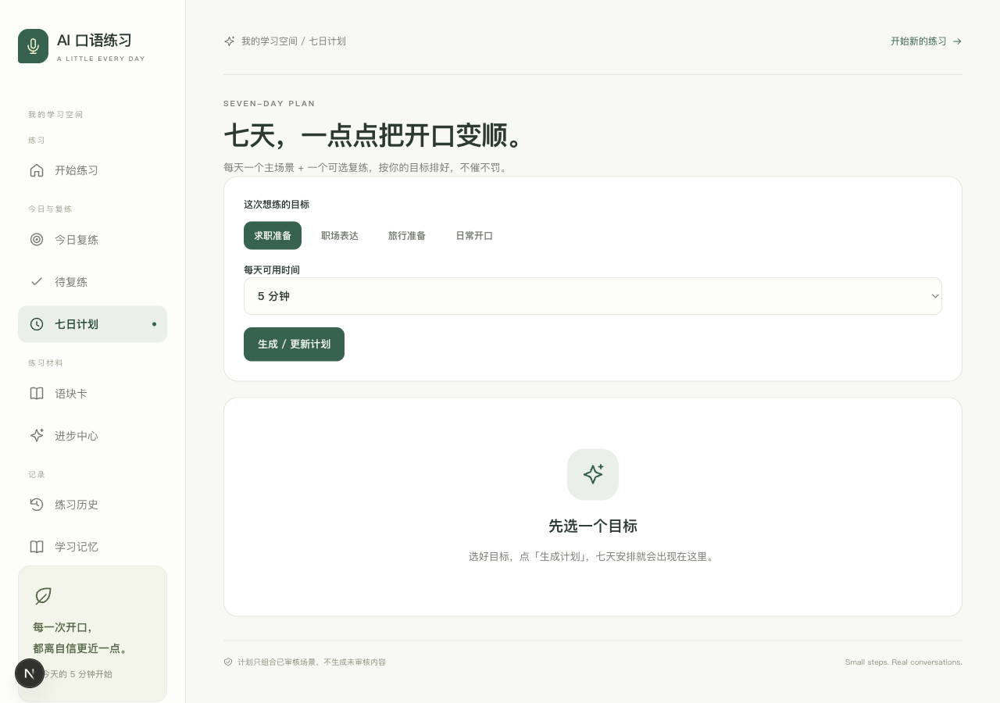

<div align="center">


# AI 口语教练｜情景对话与学习评估

**每天一次开口，都离自信更近一点。**

[快速开始](#快速开始) · [配置说明](docs/配置说明.md) · [文档导航](docs/README.md) · [项目状态](docs/项目状态.md)

</div>

## 项目介绍

面向成人英语学习者，围绕职业与面试、旅行与生活、日常沟通设计情景练习。针对提示依赖、辅助作答与独立掌握容易混淆，以及练习后缺少持续复习的问题，构建情景对话、分层帮助、独立评估与复习计划相衔接的学习流程，帮助学习者逐步过渡到独立表达。

[完整项目介绍与核心职责](docs/项目介绍.md)

## 历史界面预览



实际七日计划界面，来自本地工程验收。该截图展示页面与计划入口，不证明真实教学或语音效果。

## 核心功能

- 场景练习：对话、四类求助、录音与文字输入，以及练习回顾。
- 跟读与材料：示范和本人录音听回、语块卡、从有参考到迁移的脱稿阶梯。
- 持续复练：待复练队列、今日复练、七日训练计划与进步中心。
- 质量与隐私：学习记忆开关、录音授权与清理、专用质检权限、费用来源区分。

## 快速开始

准备 Python 3.12、Node.js 22、FFmpeg；录音需 localhost 或 HTTPS 的浏览器麦克风权限。 下列命令适用于 macOS / Linux。先安装依赖：

```bash
git clone https://github.com/Hometer/ai-speaking-coach.git
cd ai-speaking-coach
python3.12 -m venv .venv
.venv/bin/python -m pip install -r backend/requirements.txt
cp .env.example .env
npm --prefix frontend ci
```

启动服务：

```bash
# 终端一，本地离线演示，生成固定测试凭证
cd backend
PROVIDER_MODE=mock SEED_DEMO_INVITES=1 ../.venv/bin/python -m uvicorn app.main:app --host 127.0.0.1 --port 8000
# 终端二，从仓库根目录运行
npm --prefix frontend run dev
```

打开 <http://localhost:3000>；API 文档在 <http://127.0.0.1:8000/docs>。按 `Control+C` 停止对应服务。若端口已占用，后端改为 `--port 8001`，前端从仓库根目录用 `BACKEND_URL=http://127.0.0.1:8001 npm --prefix frontend run dev -- --port 3001`，访问 <http://localhost:3001>。

## 配置说明

复制根目录 `.env.example`。本地演示用 `PROVIDER_MODE=mock`，启动时显式启用 `SEED_DEMO_INVITES=1`，首页使用代码内的演示凭证 `test-a`；它仅供开发，生产禁止启用。真实模式用 `PROVIDER_MODE=real` 并自行配置百炼 Key；讯飞评测需要另外三项配置，实际词级效果待验。

详细参数、数据位置和工程检查见 [配置说明](docs/配置说明.md)。仓库不包含本机密钥、业务数据、依赖目录或运行缓存。

## 当前范围

当前处于邀请试用与产品验证阶段。真实学习效果与用户留存尚待验证。

2026-10-16 第三次质检的 **Q3-01～17 已完成本地修复**，含单句录音对比和删除全部计划两项补齐。后端 317/317、前端 25/25，类型/Lint/构建、44 组宽度与实际重启通过。[开发文档](docs/阶段文档/11-v0.10代码补漏/51-v0.10第三次质检修复开发文档.md)与[逐项证据及闸门](docs/evidence/阶段3-v0.10第三次质检修复-20261016/验收记录.md)可核对；[原质检](docs/质检/2026-10-16-v0.10第三次质检.md)保留修复前事实。离线用例通过不能保证不存在其他缺陷。

[第二次质检原报告](docs/质检/2026-10-15-v0.10第二次质检.md)保留修复前的 12 项反例；修复实现见 [50 号开发文档](docs/阶段文档/11-v0.10代码补漏/50-v0.10第二次质检修复开发文档.md)。离线通过仅说明已列用例通过，不能保证不存在其他缺陷。

整版及阶段验收仍未通过。真实教学质量、完整语音链路、讯飞词级发音证据、实际费用硬上限和内测仍待验。Mock 示范音频为静音，发音评分是示例。

以 [项目状态](docs/项目状态.md)、当前 PRD 与对应验收记录为准。历史测试与截图标明其范围，本轮修复不代替真实产品验收。

## 文档与代码

`frontend/` 为 Next.js 学习界面，`backend/` 为 FastAPI 服务；SQLite 和音频保存在被忽略的 `data/`。

[文档导航](docs/README.md) · [当前需求](docs/PRD/AI%E5%8F%A3%E8%AF%AD%E7%BB%83%E4%B9%A0PRD-v0.10.md) · [配置与检查](docs/配置说明.md)

<details>
<summary>展开开发手册、需求与验收记录</summary>

- [需求与 PRD](docs/PRD/)
- [开发手册与操作说明](docs/手册/)
- [技术适配与阶段开发文档](docs/阶段文档/)
- [验收记录与实际界面证据](docs/evidence/)
- [历史首页与分期开发记录](docs/历史/开发记录.md)
- [本次仓库整理记录](docs/仓库整理记录.md)

</details>

## 许可与来源

保留原项目 [LICENSE](LICENSE) 与作者署名。项目由 AI 产品开发工具包起步；历史规则与必要文档保留，新增整理以实际实现为准。
