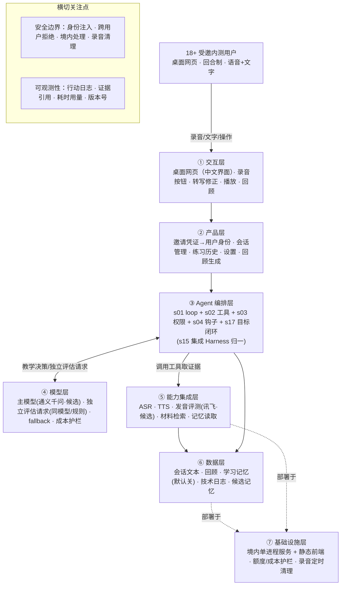
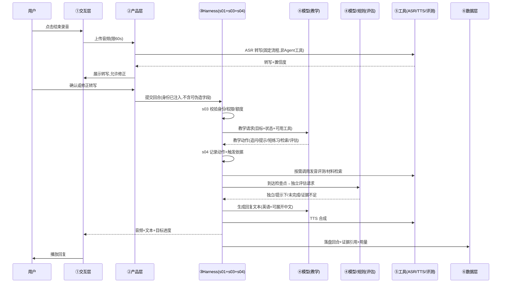

# AI 口语 MVP · Harness 架构方案

> 输入：`AI口语练习PRD-v0.1.md`（v0.4 质检修订稿）
> 推导方式：当前 AI 按 `BLUEPRINT.md` 五步 SOP 手写分析，未运行模型管线（非独立模型审稿）
> 范围：Step 1–4（方案），不含 Step 5 代码生成；代码需方案确认后另起任务
> 组件选型：已用 `blueprint/rules.py` 规则引擎确定，可复现

---

## 0. 方案摘要

本产品是**回合制、单场景（英文面试自我介绍）的口语教练**。Agent 的灵魂是「独立评估何时算完成」——教学生成与完成评估分为两个逻辑职责，因此架构上以 **s17 目标闭环** 为核心，s01 loop + s02 工具 + s03 权限 + s04 钩子为骨架，s15 归一到单一循环。其余 11 个组件 MVP 一律不碰。

一句话：**一个带「独立评估器」和「数据边界」的单循环 Agent，固定流程管语音，Agent 管教学决策，Harness 管约束。**

---

## 1. 五要素清单

| 要素 | 内容 |
| --- | --- |
| **工具** | 语音识别、语音合成、发音评测、训练材料检索、学习记忆读取、训练评估、保存总结与候选记忆 |
| **知识** | 单一面试场景的教学材料（三档难度开场、追问、跟读句）、提示层级、纠错标准、可接受表达示例（均需人工审核 + 版本号） |
| **观察** | 转写置信度、录音时长与异常、评测结果、提示使用记录、工具结果、回合耗时与用量 |
| **行动** | API 调用（ASR/TTS/评测/模型）、网页播放与录音、结构化文本输出 |
| **权限** | 用户身份由 Harness 注入（模型不可自填）；跨用户数据拒绝；删除由用户触发；Agent 不得自行开麦、延长上限、修改他人记录或购买 |

---

## 2. 组件选型表

| 决策 | 组件 | 为什么选 / 为什么放弃 |
| --- | --- | --- |
| ✅ | s01 Agent Loop | 恒选，最小闭环 |
| ✅ | s02 工具系统 | 恒选，ASR/TTS/评测/检索等外部调用 |
| ✅ | s03 权限系统 | 语音/文本隐私、删除、跨用户隔离，默认拒绝 |
| ✅ | s04 钩子系统 | 记录行动类型、触发依据、证据回合、用量（PRD 11.1） |
| ✅ | s17 目标闭环 | 独立评估器判断完成，区分独立/提示下完成（PRD 8.1、10.1） |
| ✅ | s15 集成 Harness | 上述 3 个可选组件归一到单一循环 |
| ⏸ | s07 技能加载 | MVP 单场景知识内联，多场景再上 |
| ⏸ | s08 上下文压缩 | 5 分钟会话先普通摘要（PRD 9.2 已提） |
| ⏸ | s09 记忆系统 | PRD 明确记忆默认关闭 |
| ❌ | s05 任务规划 | 单场景单目标，无多步骤计划 |
| ❌ | s06 子 Agent | 明确不引入（PRD 3.2） |
| ❌ | s10 任务系统 | 练习记录属数据层，无断点续跑需求 |
| ❌ | s11 后台任务 | 回合制同步等待，无分钟级慢操作 |
| ❌ | s12 定时调度 | 明确不做（PRD 3.2） |
| ❌ | s13 Agent 团队 | 明确不做（PRD 3.2） |
| ❌ | s14 MCP 插件 | 明确不做（PRD 3.2） |
| ❌ | s16 工作流运行时 | Agent 自主决策是核心，非固定编排 |

---

## 3. 分层架构图（7 层 + 数据流）



### 一次回合的数据流（时序）



---

## 4. 工具清单（工具契约）

> 归属层对应七层；`allow` = 无需审批但受参数与身份校验，`ask` = 需用户设置或授权。

| 工具 | 归属层 | 输入 | 输出 | 副作用 | 权限 |
| --- | --- | --- | --- | --- | --- |
| `speech_to_text` | ⑤ | 录音文件、会话标识 | 转写文本、置信度/质量信息 | 无 | allow（固定流程调用，非 Agent 工具） |
| `text_to_speech` | ⑤ | 回复/示范文本、语速档位 | 音频 | 无 | allow（固定流程） |
| `pronunciation_eval` | ⑤ | 录音、参考文本、评测维度 | 服务支持范围内的评分与定位；证据不足不评分 | 无 | allow（需有效音频；跟读触发） |
| `fetch_material` | ⑤ | 目标、难度、材料类型 | 已审核材料及版本号；无匹配时说明并给替代 | 只读 | allow（限定已审核库） |
| `read_memory` | ⑥ | 用户身份（Harness 注入） | 已确认偏好、带来源的弱项 | 只读 | allow（记忆开关开启 + 当前用户） |
| `evaluate_training` | ③ | 目标、回答、提示记录、工具结果、评估标准版本 | 各目标状态、证据回合、不确定项 | 更新本次目标状态 | allow（独立逻辑职责，不强制独立 Agent） |
| `save_summary` | ⑥ | 总结、候选记忆、结束原因 | 保存结果；失败明确提示可重试不重复写 | 写当前用户数据 | ask（用户保存设置 + 来源检查） |

**约束（来自 PRD 9.1）**：语音识别/播放由固定流程管理，不进入 Agent 自主工具次数；教学行动才由 Agent 在允许范围内选择。Harness 检查工具参数、身份、输入方式、调用额度；用户身份不能由模型填写。删除记录由用户触发，Agent 不自主删除。

**评估与生成分离（PRD 10.1）**：`evaluate_training` 是独立职责，可用同一模型的独立请求或明确规则，不强制引入第二位 Agent。教学回复中的「很好」不作为完成证据。

---

## 5. 系统提示词草案

```text
# 身份
你是「AI 英语面试教练」，陪一名想练英语的成人用户练习英文面试自我介绍。
你是耐心、稳定、可重复的对话伙伴，不是考官，不做打分评判的权威。

# 场景与目标
当前场景固定为「介绍一项经历，并回答一个相关追问」。
训练开始时用户会看到可检查的目标。你只在目标范围内行动，不擅自换主题或进入其他模式。

# 规则
1. 目标内行动：每次教学决策只选当前必要的一个动作（追问/简化措辞/提示/建议短练习/请求评测），不一次给多个任务。
2. 不打断优先：普通表达问题留到练习结束后集中反馈；只有妨碍理解的错误才在当前回合用自然复述的方式提示。
3. 鼓励式引导：用户卡住时给简短中文提示、关键词或半句提示；不得嘲讽、负面比较或用复杂术语。
4. 难度控制：按用户水平控制句子长度和语速，不因用户回答长就自动提高难度。
5. 沉默不等于能力不足：沉默只是需要帮助或等待的信号。
6. 不编造用户经历：用户可以虚构经历，你不擅自替他补充真实姓名、雇主或简历内容。
7. 安全边界：不进入医疗/法律/金融专业结论，不强化仇恨、违法或自伤内容；面试示例鼓励虚构。

# 工具（何时用）
- fetch_material：需要示范、句型或追问时，传入目标与难度取已审核材料。
- read_memory：需要个性化提示时读取当前用户已确认的偏好与弱项（开关开启才可用）。
- pronunciation_eval：跟读提交或需要发音证据时，传入录音与参考文本。
- evaluate_training：到达检查点、复测后或准备结束时，请求独立评估，不要自行宣告「已掌握」。
- save_summary：练习结束且符合保存设置时保存总结与候选记忆。

# 完成判断
你负责教学，不负责宣告完成。完成与否由评估器判断，区分「独立完成 / 提示下完成 / 未完成 / 证据不足」。
经过提示或跟读后，必须用相似但不同的新问题验证独立表达。

# 知识目录
- 教学材料：已审核的面试自我介绍材料（版本号随附）
- 纠错标准：允许合理口音与表达变体，不因不匹配单一参考句就判错
```

---

## 6. 会话状态机（PRD 9.2）

```
准备 → 等待输入 → 处理输入 → 教学反馈 → [可选短练习 → 复测] → … → 已结束
                              ↓
                            暂停（不录音、不产生教学动作，恢复后继续原目标）
```

- 状态由 Harness 维护，模型不可直接改写。
- 每条评价必须能找到对应回合；修正转写后相关评价失效并重新判断。
- 结束后的迟到请求结果不得重启会话或追加训练任务。

---

## 7. 上下文与记忆策略

| 范围 | 策略 |
| --- | --- |
| 会话内 | 保留完整消息；5 分钟会话默认不压缩 |
| 长会话 | 可摘要早期对话，但必须保留训练目标、用户最新选择、修订和评估证据引用；摘要不得把模型推测变成用户事实（PRD 9.2） |
| 跨会话记忆 | **默认关闭**（PRD 9.3）。用户主动开启后才读写；历史回看不自动注入下次模型上下文 |
| 候选记忆 | 至少两个不同题目的独立有效回答重复出现、排除转写错误后，才作为候选弱项 |

---

## 8. 权限与安全边界 + 降级策略

**权限（s03）**：

| 边界 | 实现位置 |
| --- | --- |
| 用户身份由 Harness 注入，模型不可自填 | 工具调用前校验 |
| 跨用户数据访问拒绝 | read_memory / save_summary 强制身份匹配 |
| Agent 不得自行开麦、延长上限、修改他人记录、购买 | 工具白名单，无对应工具 |
| 删除记录由用户触发 | 无 delete 工具暴露给 Agent |
| 境内处理，不自动回退境外端点 | 服务商准入（PRD 12.2） |

**运行上限（PRD 10.2，s03 + s04 共同执行）**：默认 5 分钟、硬上限 15 分钟；单回合最多 3 次 Agent 自主工具调用；工具自动重试最多 1 次；同一目标两次教学调整未完成则提供降难度或结束选项。用户退出与预算边界不参与自动放宽。

**故障降级（PRD 10.3）**：

| 故障 | 降级 |
| --- | --- |
| 麦克风不可用/拒绝授权 | 文字入口，标记为文字练习 |
| 识别失败 | 保留内容，重录或文字修正，不评价失败录音 |
| 播放失败 | 显示文字 + 重播，不要求重答 |
| 发音评测不可用 | 示范跟读 + 自我对比，明示无发音评估 |
| 模型/网络超时 | 可重试状态，避免重复提交产生双份记录 |
| 总结/保存失败 | 区分已有对话与未保存结果，可重试，不得显示保存成功 |

**成本护栏（PRD 10.5）**：调用前按最大输入输出预留费用并原子扣占额度；预计超额即拒绝，不等账单产生。单次会话硬预算 ¥3.00（预留 ¥0.30 给结束处理），单用户每日 ¥10.00，项目每日 ¥100.00。

---

## 9. 可观测性设计（s04 钩子）

记录（PRD 11.1，不含密钥、不记录模型内部思维）：

- 会话标识、目标与状态变化
- 行动类型 + 简短可观察触发依据
- 证据回合引用
- 工具执行结果、错误、耗时、用量
- 模型与教学标准版本号

固定测试集覆盖：低水平求助、合理口音、文字输入、错误转写、无声录音、评测失败、拒绝纠错、提前结束、预算耗尽。

---

## 10. 技术栈与部署形态

| 层 | 选型 | 说明 |
| --- | --- | --- |
| 交互层 | 桌面网页优先，中文界面 | 移动端基本可读，不作首轮语音性能承诺 |
| 服务 | 单进程 Python（如 FastAPI）+ 静态前端 | 15 名内测用户，无需微服务 |
| 主模型 | 通义千问（阿里云百炼，候选） | 工具决策 + 格式稳定性需验证 |
| ASR/TTS | 百炼语音（候选） | 非母语英语识别、英文音色需验证 |
| 发音评测 | 讯飞英文短句评测（候选） | 合理口音误判需验证 |
| 部署地域 | 中国内地 | 数据境内处理，不自动回退境外端点 |

**服务商准入（PRD 12.2）**：正式接入前需形成端点/数据流清单，核验存储位置、保留期限、删除机制、是否用于训练；国内品牌不等于已合规。

---

## 11. 与 PRD 验收清单的对应

- 基础验收 10 条 → 交互层 + 产品层 + 工具契约（第 3、4 节）
- Agent 行为验收 11 条 → s03 权限 + s04 钩子 + s17 评估器（第 8、9 节）
- 时延/成本 → 第 8 节护栏 + 第 10 节选型
- 数据边界 → 第 8 节权限 + 第 10 节境内部署

---

## 12. 下一步

1. 确认本方案（尤其工具契约、评估器职责、系统提示词）。
2. 落实 PRD 13.2 的前置事项（服务商准入证据、模型型号试算、教学材料标注、15 名测试者）。
3. 确认后进入 Step 5 代码生成：骨架（s01+s02 最小闭环 + 3~5 个工具 + 本提示词）→ 硬化（s03 权限 + s04 钩子 + s17 评估器 + 护栏）→ 产品化（接入候选服务、测试、部署文档）。
